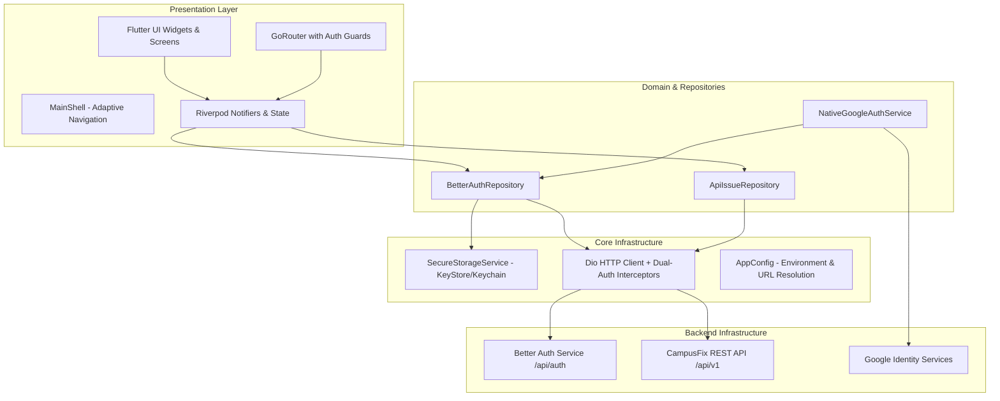

# CampusFix Mobile — University Facilities & Incident Operations

CampusFix Mobile is the official Flutter client for the **CampusFix** facility operations and incident reporting platform. It provides university students, faculty, and maintenance operators with a tactile, accessible, and resilient mobile interface to report campus infrastructure failures, track repair progress, and coordinate facilities maintenance.

---

## 1. Project Overview

### Problem Statement & Mission
Campus infrastructure incidents (broken lighting, electrical faults, plumbing leaks, HVAC failures, damaged laboratory equipment) disrupt education and campus life. CampusFix provides an end-to-end incident lifecycle from report submission and automated triage to technician assignment and verified resolution.

### Target Users & Roles
- **MEMBER (Students & Faculty)**: Browse recent campus incidents, report new issues with location and urgency, track resolution progress, and manage personal profile settings.
- **STAFF / TECHNICIAN**: Access the technician operations queue, filter assigned work orders, and review resolution histories.
- **ADMIN**: Institutional management and oversight.

### Current Implementation Status
- **Authentication**: Fully restored. Multi-strategy token extraction supports top-level JSON tokens, nested `session.token`, and `Set-Cookie` (`__Secure-better-auth.session_token`).
- **Session Transport**: Injects both `Authorization: Bearer <token>` and `Cookie: better-auth.session_token=...` on all protected API calls.
- **Navigation & Route Guards**: GoRouter with reactive Riverpod authentication state listener. Protects `/report-issue` while allowing campus community incident browsing.
- **Design System**: High-contrast, institutional navy and amber aesthetic with full Light and Dark themes, responsive layout, and overflow protection.
- **Automated Tests**: 104 tests passing (100% green) covering Better Auth repository, Google Sign-In, navigation shell, issue models, and UI flows.

---

## 2. Architecture

CampusFix Mobile follows Flutter's recommended layered, feature-driven architecture, strictly isolating presentation, domain state, repositories, and HTTP networking.



---

## 3. Prerequisites for a Fresh Windows Machine

Ensure the following tools and compatible versions are installed on your Windows machine:

| Tool | Required Version | Verification Command | Description / Purpose |
| :--- | :--- | :--- | :--- |
| **Git** | `2.40+` | `git --version` | Version control management |
| **Flutter SDK** | `3.47.7` (channel `stable`) | `flutter --version` | Framework and runtime |
| **Dart SDK** | `3.13.5` | `dart --version` | Bundled with Flutter SDK |
| **Java JDK** | OpenJDK 17 (`Java 17`) | `java -version` | **Required** by Gradle 8.x/9.x and Kotlin 2.x |
| **Android Studio** | Latest Stable | `flutter doctor -v` | Android SDK, command-line tools, and emulator |
| **Android SDK** | API 36 / 37 | SDK Manager | Compile SDK: `36`, Target SDK: `36`, Min SDK: `24` |
| **Platform Tools** | Latest | `adb devices` | Android Debug Bridge for USB device testing |

---

## 4. Clone and Initial Setup

Follow this sequence when setting up a fresh development laptop:

### Step 1: Install OpenJDK 17 & Configure Environment Variables
Download Microsoft Build of OpenJDK 17 or Eclipse Temurin 17. In Windows System Environment Variables:
- Set `JAVA_HOME` = `C:\Program Files\Eclipse Adoptium\jdk-17...`
- Add `%JAVA_HOME%\bin` to your `Path`.

### Step 2: Clone the Repository
```powershell
git clone <YOUR_EXISTING_REPOSITORY_URL>
cd CampusFix-Mobile
```

### Step 3: Install Flutter Dependencies
```powershell
flutter pub get
```

### Step 4: Verify Local Toolchain Health
```powershell
flutter doctor -v
```

### Step 5: Run Static Analysis & Test Suite
```powershell
dart format --output=none --set-exit-if-changed lib test
flutter analyze
flutter test
```

---

## 5. Environment Configuration

All environment configuration is managed via typed compile-time flags (`--dart-define`) and `.env.example`.

### Pre-Configured Keys

| Key Name | Purpose | Required? | Default Value | Nature | Used By |
| :--- | :--- | :--- | :--- | :--- | :--- |
| `ENVIRONMENT` | Target environment (`production`, `staging`, `development`) | Optional | `production` | Public | Flutter |
| `API_BASE_URL` | Versioned REST API endpoint base URL | Optional | `https://campusfixed.netlify.app/api/v1` | Public | Flutter / Dio |
| `AUTH_BASE_URL` | Better Auth endpoint base URL | Optional | `https://campusfixed.netlify.app/api/auth` | Public | Flutter / Better Auth |
| `GOOGLE_SERVER_CLIENT_ID` | Web Client ID for validating Google ID token audience | Optional | `440612845967-ggac7dh53iktbpo8t38qaj392kp5kk5v.apps.googleusercontent.com` | Public Identifier | Flutter / Google Sign-In |
| `GOOGLE_CLIENT_ID` | Optional Android client ID override | Optional | (resolved automatically by package name & SHA-1) | Public Identifier | Flutter / Android |

> **Security Note**: Public Client IDs and base URLs are public identifiers, not secrets. Never commit OAuth client secrets, private keys, database connection strings, or keystores to version control.

---

## 6. Authentication Documentation

### 6.1 Email / Password Registration & Login
- **Login Endpoint**: `POST /api/auth/sign-in/email`
- **Registration Endpoint**: `POST /api/auth/sign-up/email`
- **Request Body**:
  ```json
  {
    "email": "name@university.edu",
    "password": "user_password"
  }
  ```
- **Token Resolution**: The client extracts the session token defensively from:
  1. `data['token']`
  2. `data['session']['token']` or `data['session']['id']`
  3. `Set-Cookie` header (`better-auth.session_token` / `__Secure-better-auth.session_token` / `campusfix_authorization`)
- **Profile Resolution**: Parses user details directly from `data['user']` or verifies against `GET /api/v1/auth/me` (with fallback to `GET /api/auth/get-session`).

### 6.2 Session Persistence & Restoration
- Tokens are encrypted in secure storage (`FlutterSecureStorage`).
- During application startup, `AuthNotifier.restoreSession()` inspects secure storage and restores the active session. If the token is invalid or expired (401), the local token is cleared cleanly.

### 6.3 Google Native Sign-In
- **Package Name**: `com.campusfix.app`
- **Debug Signing SHA-1**: `4C:79:E9:2A:51:2E:A6:97:F3:6E:5E:9A:41:E5:3D:6D:71:7F:D8:EE`
- **Web Client ID (Server Audience)**: `440612845967-ggac7dh53iktbpo8t38qaj392kp5kk5v.apps.googleusercontent.com`
- **Workflow**: Native Google Play Services prompts account selection → returns verified OIDC ID token → exchanged at `POST /api/auth/sign-in/social` with Better Auth.

### 6.4 GitHub OAuth
- Intent filters in `AndroidManifest.xml` listen on `campusfix://oauth-callback`.
- When initiated via web browser, Better Auth redirects back to the mobile deep link, where `handleOAuthCallback(token)` persists the session.

---

## 7. Running, Testing, and Building

### Run on Connected Device or Emulator
```powershell
flutter run
```

### Run with Explicit Production Endpoint
```powershell
flutter run --dart-define=ENVIRONMENT=production --dart-define=API_BASE_URL=https://campusfixed.netlify.app/api/v1
```

### Run with Local Backend (Port 5000)
- **Android Emulator**:
  ```powershell
  flutter run --dart-define=ENVIRONMENT=development --dart-define=API_BASE_URL=http://10.0.2.2:5000/api/v1
  ```
- **Physical Phone via USB (ADB Reverse)**:
  ```powershell
  adb reverse tcp:5000 tcp:5000
  flutter run --dart-define=ENVIRONMENT=development --dart-define=API_BASE_URL=http://localhost:5000/api/v1
  ```

### Code Quality & Automated Tests
```powershell
dart format --output=none --set-exit-if-changed lib test
flutter analyze
flutter test
```

### Build Android Debug APK
```powershell
flutter build apk --debug
```
Output location: `build/app/outputs/flutter-apk/app-debug.apk`

---

## 8. Troubleshooting Guide

| Issue | Root Cause | Solution |
| :--- | :--- | :--- |
| **`ERROR: JAVA_HOME is not set`** | Java JDK is not installed or `JAVA_HOME` variable is missing | Install OpenJDK 17 and configure `JAVA_HOME` pointing to the JDK root directory |
| **`Unable to reach server` (Connection Refused)** | Defaulting to `10.0.2.2:5000` when no local backend is running | The app now defaults to `https://campusfixed.netlify.app/api/v1`. For local dev, ensure the local server is running and run `adb reverse tcp:5000 tcp:5000` |
| **Google Sign-In `DEVELOPER_ERROR` (Code 10)** | Signing SHA-1 mismatch or Web Client ID mismatch | Verify `com.campusfix.app` and local debug SHA-1 in Google Cloud Console Credentials |
| **Authentication token not returned** | Better Auth returned token in `session` or `Set-Cookie` | Fixed in `BetterAuthRepository` with multi-strategy token extractor |
| **Session not persisting across restarts** | Unauthenticated screen flashed before session restoration | Handled by GoRouter reactive listenable and `AuthNotifier.restoreSession()` |
| **Android Deep Link Not Opening App** | Intent filter not registered or URL scheme mismatch | Ensure deep link targets `campusfix://oauth-callback` or `https://campusfixed.netlify.app/issues` |

---

## 9. Project Continuity & New-PC Handoff

### Files That Must Be Committed:
- `lib/` (application source code)
- `test/` (automated test suite)
- `android/` (native project files, `build.gradle.kts`, `AndroidManifest.xml`, Gradle wrapper)
- `pubspec.yaml` and `pubspec.lock` (dependency definitions and exact resolved versions)
- `.gitignore` (properly configured ignore rules)
- `.env.example` (environment template)
- `docs/` (technical documentation)
- `README.md` (master handoff guide)

### Local Files That Must NEVER Be Committed:
- `android/local.properties` (contains older laptop's local paths `C:\Users\shaik\...`)
- `.env` files containing private credentials
- Keystore files (`*.keystore`, `*.jks`, `key.properties`)

---

## 10. Related Documentation

- [docs/AUTHENTICATION.md](docs/AUTHENTICATION.md) — Technical details on Better Auth token exchange, dual-header transport, and OAuth flows.
- [docs/DEVELOPMENT_HANDOFF.md](docs/DEVELOPMENT_HANDOFF.md) — Step-by-step developer onboarding checklist for new development laptops.
- [docs/mobile/PRODUCT_SPEC.md](docs/mobile/PRODUCT_SPEC.md) — CampusFix Mobile product specification and requirements.
