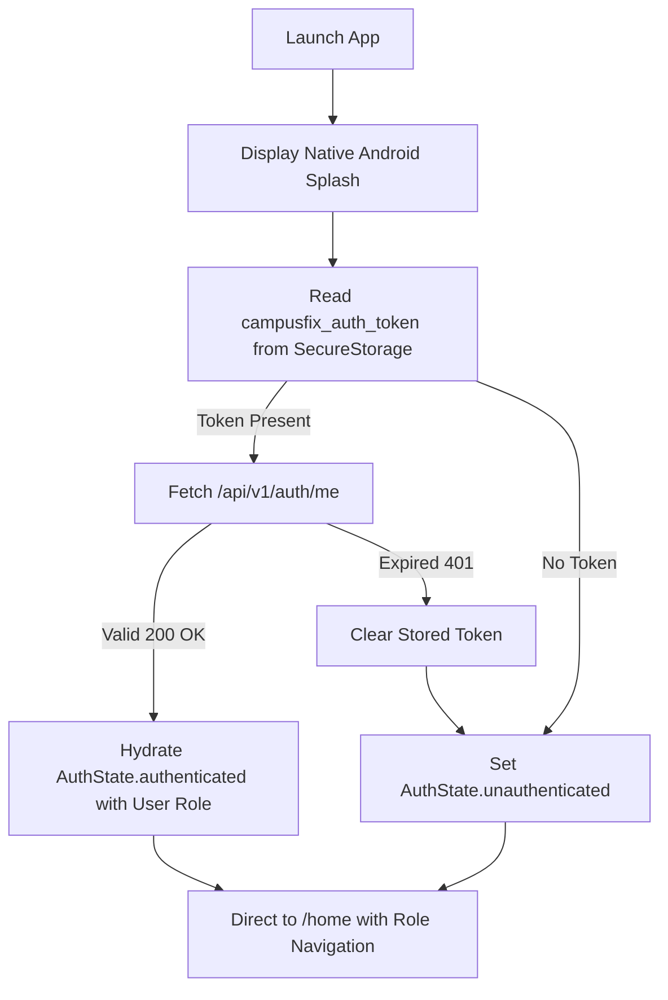
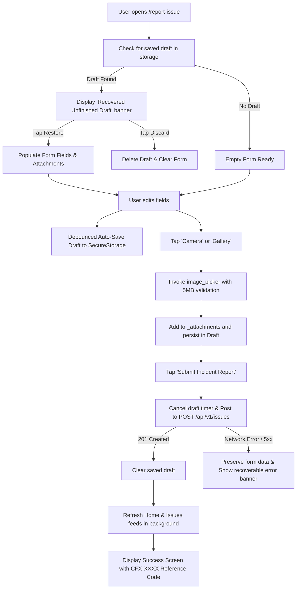
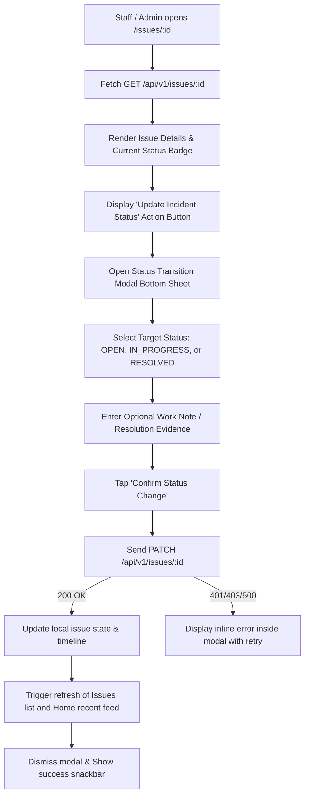

# CampusFix Mobile — End-to-End User Flows

## Flow 1: First Launch & Session Restoration

## Flow 2: Reporting an Incident with Native Photo & Draft Recovery

## Flow 3: Technician & Admin Status Transition

